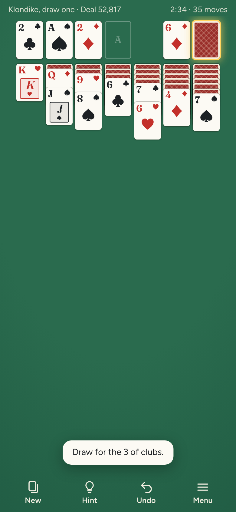
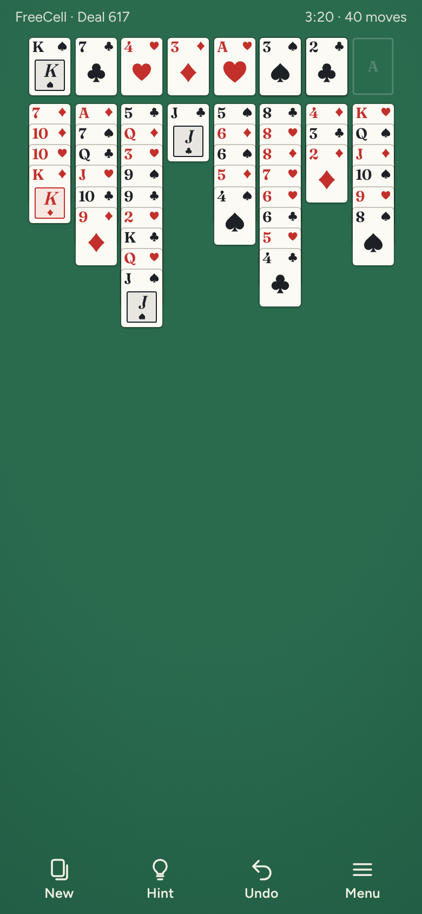
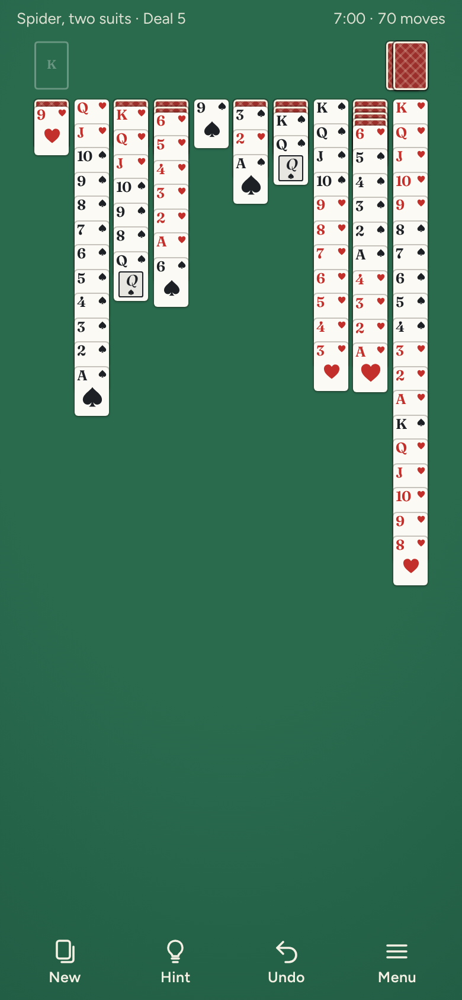
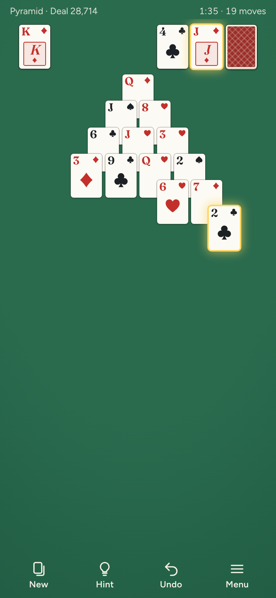
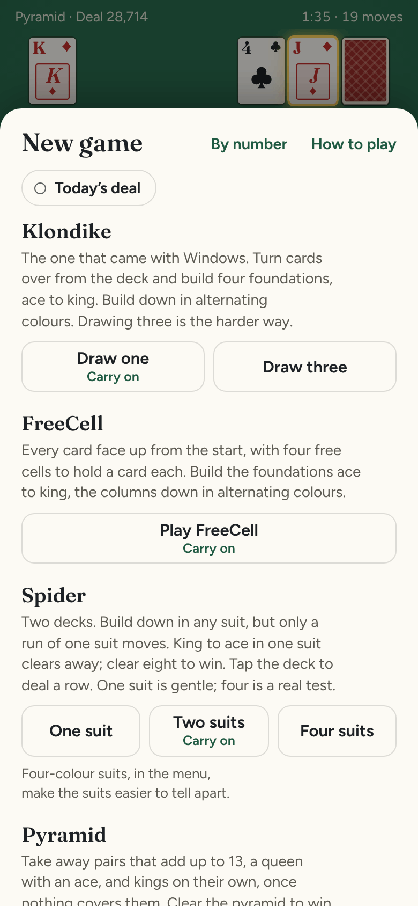
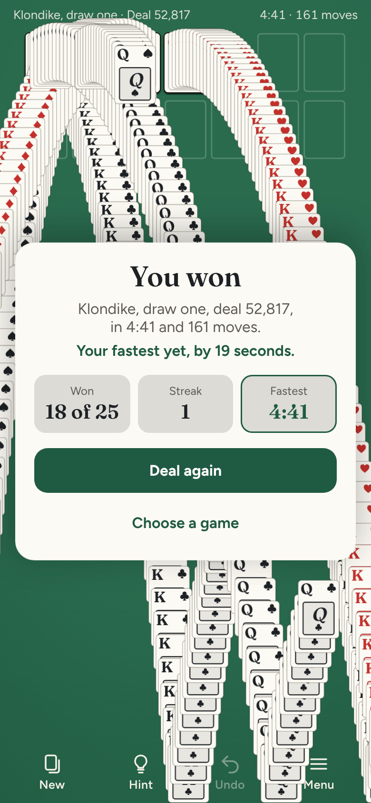

# Patience

**Play it: [patience.junkdrawer.works](https://patience.junkdrawer.works/)**

**Klondike, FreeCell, Spider and Pyramid solitaire with no ads, no account and nothing to wait for.** Tap a card to send it where it fits or drag it there yourself, and undo as far back as you like. Every deal has been played through before it reaches you, so there's always a way to win, and the Hint button knows it.

<p align="center">
  
  &nbsp;
  
  &nbsp;
  
</p>
<p align="center">
  
  &nbsp;
  
  &nbsp;
  
</p>

## How it plays

- **Klondike, the one that came with Windows.** Build the four foundations from ace to king, one suit each. In the seven columns, cards go down in alternating colours, and only a king can go in an empty column. Draw one card at a time or three, and go through the stock as many times as you like. You can drag a card back down from a foundation onto a column if you need it there (or tap it, when Hint has lit it up).
- **FreeCell.** All 52 cards face up from the start, four free cells to hold a card each, and any card can go in an empty column. A run moves as one when there'd be room to move it a card at a time. The deals are numbered the way the FreeCell that came with Windows numbered them, so game 617 here is game 617 there.
- **Spider, with one, two or four suits.** Two decks in ten columns. Build down in any suit, but only a run of one suit moves together, and a run from king to ace of one suit clears away. Tap the deck to deal a row, once every column has a card, or, with fewer than ten cards left on the table, once each of them has a column to itself. Clear all eight runs to win.
- **Pyramid.** Twenty-eight cards face up in a pyramid of seven rows, each row half covering the one above. Take away pairs that add up to 13 (a jack counts 11 and a queen 12, so a queen goes with an ace), and kings on their own, but only cards with nothing on them. Tap the deck to turn a card up: it can pair with a card in the pyramid or with the top card of the waste beside it, where the card turned up before it went. You can go through the deck three times, and the empty deck says how many more. Clear the pyramid to win, whatever is left in the deck. These are the rules in [Wikipedia's Pyramid article](https://en.wikipedia.org/wiki/Pyramid_(solitaire)): its three times through the deck is the version it calls Par Pyramid, where the waste is turned over and dealt again twice, and clearing just the pyramid is what it calls Relaxed Pyramid.
- **Tap or drag.** A tap sends cards to the best place: up to a foundation if they can go, otherwise onto a column (in FreeCell, a single card from a column goes onto a card it fits, then to a free cell, and only then to an empty column, which is kept for a run; in Spider, a card of the same suit first, and a card in a run of its own suit only onto another card of that suit; in Pyramid, a tap on a king takes it away, and a tap on any other card picks it, standing it up a little, and a tap on the card it pairs with takes them both). Hint lights up a card and where it goes: tap either one and the move is played. Drag a card, or a run, anywhere the rules allow, and the place it would land lights up softly as you hold it there; drop it somewhere it doesn't fit and it slides back, saying why when it's a rule you mightn't know yet: only a king can go in an empty Klondike column, how many cards FreeCell has room to move together, (once a deal) that only a run of one suit moves together in Spider, and, in Pyramid, that a pair adds up to 13 and that a covered card has to wait.
- **A first word.** The first time you're dealt each game on a phone, one line says how it plays, with a How to play button that opens its rules in the menu. The New game sheet has a How to play button too.
- **Undo all the way back,** even after closing the page and coming back to it.
- **A game waiting for each way of playing.** Try FreeCell in the middle of a Klondike game and your Klondike game waits where you left it, with its Undo and its clock: choose Klondike again in New game, where it says Carry on, and you're back in it. Only a new deal of the same way counts a game you're part way through as a loss.
- **Deals that can be won.** Before a deal reaches you, a solver plays it through, seeing every face-down card, and any deal it can't win in time is shuffled away. So that you never wait for one, the first game of each way of playing comes from a list of deals already checked, and the next is found in the background while you play. Turn this off in the menu if you'd rather take your chances.
- **Today's deal.** Press Today's deal in the New game sheet and each game's button plays today's deal of it, the same on every phone that day, worked out from the date with nothing sent anywhere. They're picked in advance, so every one can be won and none has to be found while you wait. Your record keeps the time you first won today's deal in, and how many days in a row you've won it, so you can set your time beside a friend's.
- **A deal by number.** Every game shows its deal number at the top, apart from Today's deal, which shows its name there instead. Tap By number in the New game sheet and type one, and each game's button plays that deal of it: up to 32,000 in FreeCell and 999,999 in the others. It's dealt as asked, without the check that it can be won, so you can have another go at a deal, play the same one as a friend, or try FreeCell's 11,982, the famous one that can't be won.
- **A hint that knows the way.** Hint asks the same solver for the next move from where you are, and while you do what it says, it keeps to the way it found, even when you try something else, ask it there, and undo back. When it's drawing for a card further down the deck, it says which one. If an earlier move has left no way to win, it says so, and Take me back goes back as many moves as it takes to where the game can still be won, says how many, and shows the way on from there; Undo beside it goes back one move at a time. And once no move you could make would ever help, the game says so without being asked, with the same Take me back.
- **Cards go up by themselves** in Klondike and FreeCell once nothing on the table could still need them, and when the rest is in order the game finishes itself. Drawing one, that's as soon as every card in the columns is face up, turning cards from the deck as it goes. You can switch the first part off.
- **The bouncing cards** when you win, as tradition requires.
- **Your record** for each of the seven ways of playing: games played, won, win rate, streak, best streak, fastest win, fewest moves, and Today's deal: how long it took today, and days in a row. Clear this record, under it, starts one way of playing again from nothing, after asking once. Save a copy of your record, at the foot of the menu, gives you a small file, named something like patience-record-2026-11-23.json, with your record and settings in it; Bring back a record, on a new phone or after your browser has cleared its data, adds it to the record there and brings the settings back. No record is ever added twice, even one that came across inside another phone's copy.
- **Settings:** only deal games that can be won, send cards up by themselves, show the time and moves, four-colour suits (clubs green, diamonds blue), the deck on the left instead of under your right thumb, and the look: light or dark, or whatever your phone is set to.
- **On a keyboard,** you can play every move. The arrow keys choose a card or a place, with a ring round it, and 1 to 9 and 0 jump to a column. Enter does what a tap there would; Space picks the cards up, and again puts them down where the arrows have taken them, outlining the place while they can go there; Escape puts them back. In Pyramid the arrows go along the pyramid's rows and up and down between them, and Enter picks a card and pairs it, as a tap does. Space on the deck, or with nothing chosen, uses the deck in Klondike, Spider and Pyramid (so does D). Z undoes, H gives a hint, Enter plays it and N opens New game (Enter there deals another of the same).
- No ads, no account and no server. Your games, your record and your settings stay in your browser. It works offline and installs to a phone's home screen. On an iPhone, installing it keeps your record safest: Safari clears what a site has saved after seven days of using Safari without opening it, and an app on the home screen keeps its own count.

## Running it

It's a static site: plain HTML, CSS and JavaScript, with no build step.

```sh
npm start                         # or any static file server; then open http://localhost:8080
npm install                       # once, for the bundler and the PNG compressor the screenshot and icon tools use
npm test                          # the rules and the solvers in Node, then every game played in Chromium (needs Playwright)
node tools/screenshots.mjs        # redraws docs/*.png and og.png (--check lists any that no longer match, changing nothing)
node tools/make-icons.mjs         # redraws the PNG icons from icon.svg
npm run build                     # bundles everything into dist/patience.html, one file you can send around
node dev/solver-check.mjs 200 3   # solves 200 Klondike deals drawing three, and replays every win through the rules
node dev/freecell-check.mjs 100   # the same for FreeCell, checking every move by its own rules
node dev/spider-check.mjs s2 30   # the same for Spider with two suits (s1, s2 or s4)
node dev/pyramid-check.mjs 100    # the same for Pyramid
node dev/ready-deals.mjs k3 50    # rewrites the list of deals checked in advance for one way of playing (--check checks them all)
node dev/daily-deals.mjs all 366  # makes the lists for Today's deal 366 days long, keeping the days already there (--check checks them all)
node dev/hint-check.mjs k3 50     # plays 50 deals doing just what Hint says, and lists any it doesn't win (with `on daily` after it, Today's deals)
```

To put it online with GitHub Pages: **Settings → Pages → Build and deployment → Deploy from a branch**, then pick `main` and `/ (root)`.

### Files

- `js/games/`: the rules of each game, all with the same parts so the rest of the app doesn't need to know which is being played (`index.js` lists them and what each part does). `ready-deals.js` is the list of deals checked in advance for each way of playing, so the first game of each needn't wait, and `daily-deals.js` the deals for Today's deal, a year of them for each way of playing, every one won by the solver, starting on 23 November 2026 and coming round again after that.
- `js/solvers/klondike.js`: the Klondike solver. A depth-first search that sees the face-down cards, offers every card the stock can reach as a move of its own, and never looks at the same position twice. Drawing three, it allows for a card going up by itself from the waste, which changes what later draws turn over, so a deal it hands out can be won with that setting on or off. To be quick it leaves out moves that seldom help, like moving part of a run or taking a card back down, so before Hint says a game can't be won, or the game says there are no moves left, it looks again with every move. In the 100,000 positions it gets to check a deal before it reaches you, it wins about 79% of deals drawing one and 68% drawing three.
- `js/solvers/best-first.js`: a best-first search shared by the FreeCell and Spider solvers, which always looks next at the most promising position found so far. Spider's keeps each position it has still to look at as a short line of characters and builds the table again when it gets to it, so even a four-suit search that runs to its limit takes tens of megabytes, not hundreds.
- `js/solvers/freecell.js`: the FreeCell solver. In the 100,000 positions it gets to check a deal before it reaches you, it wins 98 of the first 100 Windows deals in about a tenth of a second each (99 in the 200,000 Hint gets), and proves game 11982, the famous one, can't be won.
- `js/solvers/spider.js`: the Spider solver. In the 120,000 positions it gets to check a deal before it reaches you, it wins nearly every one-suit deal and nine in ten two-suit deals; four-suit deals are harder, about one in four. To be quick it leaves out moves that seldom help, like moving only part of a run, so before Hint says a game can't be won it looks again with every move.
- `js/solvers/pyramid.js`: the Pyramid solver. A depth-first search that sees the whole deck, offers every card the deck can still turn up as a move of its own, and gives up on a position as soon as a card in the pyramid has nothing left to pair with (every card of the rank it needs gone, or covering it, or under it). In the 100,000 positions it gets to check a deal before it reaches you, it wins about 65% of deals and proves about 20% can't be won.
- `js/deals.js`: runs a solver a slice at a time, between frames, to find winnable deals and hints, and for Take me back, the last move a game could still be won from.
- `js/table.js`: the table. Card sizes and layout for whichever game it is, the movement, tapping and dragging, and choosing and moving cards by keyboard.
- `js/win.js`: the bouncing cards.
- `js/words.js`: what each move did, in a few words, for a screen reader to read out once it has settled.
- `js/edge-guard.js`: keeps a Back that comes in the middle of a drag (a swipe near the side of a phone's screen) from closing the game.
- `js/app.js`: the game itself: undo, the clock, the record, settings and saving.
- `js/cards.js`, `js/suits.js`, `js/rng.js`: the cards, the four suit shapes, the seeded shuffle that turns a deal number into a deal, and Windows' FreeCell shuffle.
- `fonts/`: Fraunces and Figtree, served from here so nothing loads from elsewhere. They're under the SIL Open Font License, which comes with them in `OFL.txt`.
- `sw.js`: keeps a copy for playing offline. On a connection that isn't answering, a page opens from that copy after four seconds. `FILES` in it is a fingerprint of the files it keeps: change one and `npm test` says what to set it to, so a release never leaves the copy half old.
- `test/`: the rules and the solvers in Node, and every game played through the real page.
- `scripts/build.mjs`: makes dist/patience.html, the one file you can send around (and dist/artifact.html, the same without the page around it, for places that supply their own).
- `tools/`: redraws the screenshots, the link preview and the icons.
- `dev/`: tools used while building it: the solver and Hint checks, quick screenshots, and a helper that plays a deal part way.
- `LICENSE`: MIT, so you can take it and make it your own.
